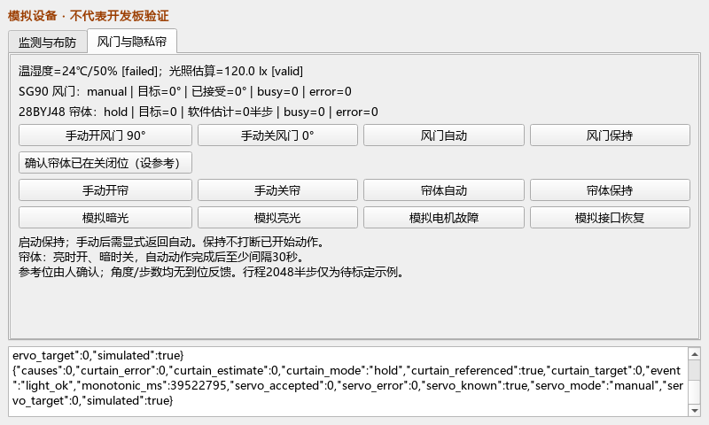

# 执行器恢复：结果与适用范围

日期：2026-11-17。基准提交 `35eb1a0`。本轮重新接入 SG90 和 28BYJ48/ULN2003，并收敛为室内环境辅助控制及离场布防。测试版本由 evidence 的源包 SHA256、源码与产物指纹识别；不把基准提交当成被测版本。

## 实现与原因

| 原问题 | 实现及取舍 | 关键源码 |
|---|---|---|
| 步进整程 ioctl 数秒才返回，直接调用会占住控制线程 | 两个独立执行器线程，每通道最多一条未完成命令；忙时保留最新目标 | [策略与执行器](../../core/actuators.cpp)、[Qt 交付](../../app/mainwindow.cpp) |
| 手动指令易被下个采样覆盖；失效读数仍可能联动 | 启动保持；手动持续接管、显式返回自动；对应输入失败或超期不发新自动命令 | [策略](../../core/actuators.cpp) |
| 明暗波动导致反复动作 | 双阈值回差、中间区间保持；前次完成后 30 秒内不调度下一次自动帘体动作，人工操作不受此间隔限制 | [策略配置](../../core/actuators.h) |
| 无位置反馈却把步数当成到位 | 人工确认关闭参考位后才运行；失败使估计失效，不重试相对命令 | [策略](../../core/actuators.cpp)、[Linux 接口](../../core/linux_devices.cpp) |
| 部分执行后的信号重启可能重放步数 | 驱动循环中断返回 EINTR；不返回可能自动重启的 ERESTARTSYS | [步进驱动](../../01-驱动层/step28byj48.c) |
| SG90 probe 会居中，角度 ioctl 忽略 PWM 错误 | probe 禁用 PWM，显式角度命令才启用；传播配置/启用错误；退出可停用 PWM | [舵机驱动](../../01-驱动层/sg90.c) |

PIR 不参与电机决策，只保留人工离场布防后的活动提醒。LOW 不证明无人，也没有人员身份识别。帘体按日间采光、暗时隐私设计；不是已经验证的防晒或节能方案。SG90 只移动小风门，不产生风力。

## 验证结果

| 项目 | 实际结果 | 直接证据 |
|---|---|---|
| Windows CMake / Qt 6.11.1 / MinGW 13.1 | CTest 6/6；原监测 7 场景、新执行器 4 场景、Qt 流程、拒绝隐式模拟、声光/舵机关闭失败退出码 | [最终回归](../../evidence/2026-11-17-actuator-restore/04-final-windows/build-and-tests.log) |
| Qt 模拟界面 | 默认不移动；人工设参考后运行；步进故障使估计失效，恢复接口仍需重设参考；输入故障及静音仍有效 | [操作日志](../../evidence/2026-11-17-actuator-restore/01-windows-r1/workflow.log)、下方截图 |
| qmake / Qt 6 | 新工程构建及同组模拟流程通过 | [构建](../../evidence/2026-11-17-actuator-restore/05-qmake-windows/build.log)、[流程](../../evidence/2026-11-17-actuator-restore/05-qmake-windows/workflow.log) |
| Linux 5.4 x86_64 / GCC 9.4 | 11 个核心场景通过；普通文件伪设备拒绝测试包含两个电机节点 | [R2 测试](../../evidence/2026-11-17-actuator-restore/03-linux-r2/tests.log) |
| Linux ASan/UBSan | 同组测试通过，未见 sanitizer 诊断 | [R2 原始日志](../../evidence/2026-11-17-actuator-restore/03-linux-r2/sanitized-tests.log) |
| 内核模块 | HC-SR505、SG90、28BYJ48 在 5.4 主机头文件下编译通过，未加载 | [R2 编译](../../evidence/2026-11-17-actuator-restore/03-linux-r2/driver-build.log) |

### 慢动作隔离的直接观察

测试先确认步进已进入可控闸门，再提交舵机命令并等待额外 4 次光照更新。Windows 最终轮、Linux R2 原生及 sanitizer 轮均观察到：步进尚未返回，光照额外更新 4 次，舵机命令已经完成；第二条步进请求被拒绝。原始机器可读项为 `gated_stepper_host_substitute`。

这里光照测试周期是 20 ms，实际程序默认 1000 ms。结论是调度隔离及命令容量限制成立；没有与旧版在同一板端做 A/B，不是 i.MX6ULL 响应时间、CPU 降幅或机械速度提升。模式、30 秒门槛与回差由受控时钟状态序列验证，不等于现场抖动率测量。

### 失败轮次

Linux R1 核心测试通过，但步进编译因较新内核拆分 `signal_pending` 的声明头文件而失败，sanitizer 尚未执行。增加按内核版本包含 `sched/signal.h` 后，R2 模块、普通与 sanitizer 测试均通过。[R1 失败日志](../../evidence/2026-11-17-actuator-restore/02-linux-r1/driver-build.log)保留，不覆盖。

## 收益、代价和未验证内容

代码层可确认：慢步进不占 UI/采集线程；相对动作不排成长队；手动不会被自动覆盖；失败位置不继续当成已知；PWM 错误及退出失败能传播。代价是两个工作线程、状态协调及人工参考位操作，尚无板端资源占用测量。

正常退出丢弃未开始任务并等待已开始 ioctl，随后曾尝试舵机命令则停用 PWM；Hold 也不能中途取消步进。停用 PWM 不保证机械保持力或回到某个位置，不能称为急停或自动安全归位。

未验证：Qt 5.12.9/ARM 及 Linux 4.1.15 构建与部署，实际 PWM/相序、极性、机构总行程/负载/丢步、参考位操作、采样成功率及电气异常、UI/输出物理延迟、通风降温除湿或遮光/隐私效果、CPU/内存与长期运行。默认角度、2048 半步和 30/80 光照门槛均需标定；无编码器/限位，不能发现外力移动或堵转。

实现和本轮主机验证由自动化工具辅助完成；未在 i.MX6ULL 上操作，结果不作为维护者独立调试掌握程度或历史板端演示的证明。[复现命令与证据目录](../../evidence/2026-11-17-actuator-restore/README.md) · [目标环境恢复](board-restoration.md)
