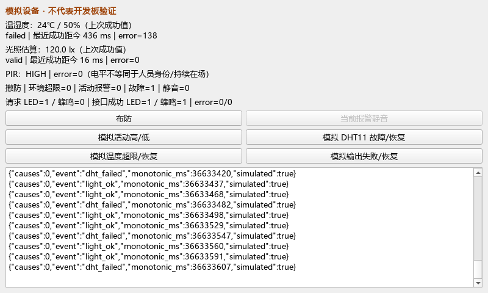

# 阶段结果：代码与主机验证

日期：2026-11-17。重构基准为 e015ddd；测试以 evidence 中保存的源码指纹、环境和原始日志识别，不将基准提交等同于最终被测代码。

本页记录首次收敛阶段，包含当时未接入电机的范围。后续执行器恢复及当前状态见[新阶段结果](actuator-results.md)；不改写本页历史证据。

## 已实现

- 新主程序只构建 Qt Widgets、C++ 业务核心和设备后端，移出 OpenCV、视觉、考勤网络及电机联动。旧程序仍在历史目录，不参与新构建。
- 温湿度、光照、PIR 分别调度；失败不在同一采集线程内连续睡眠重试。UI 线程单独拥有业务状态，工作线程只通过排队信号传递结果。
- 数据保存最近成功/尝试时间、失败计数和有效期。温湿度超限具有回差，失败/过期不解除上次已知超限；输入故障与活动报警分开，布撤防和静音有明确规则。
- UI 区分输出请求与写接口结果。停止时先停止并回收工作线程，再请求关闭输出；真实内核调用不返回时，不能保证固定退出期限。
- HC-SR505 增加 .poll、启动电平快照、单读取者和同步读取。旧驱动不匹配时用户态报告故障并退避，不进入空转重试。

## 验证结果与直接证据

| 验证 | 实际结果 | 范围 |
|---|---|---|
| Windows Qt 工具链探针 | Qt 6.11.1/MinGW 13.1 64 位，编译、按钮事件和渲染通过 | [探针](../../evidence/2026-11-17-local-monitor/01-windows-qt/run.log) |
| Windows CMake 最终构建与回归 | 7 个核心场景通过；Qt 模拟操作、拒绝隐式模拟、关闭输出失败传播通过；CTest 4/4 | [最终复核](../../evidence/2026-11-17-local-monitor/07-shutdown-review/build-and-tests.log) |
| Qt 模拟流程 | 默认撤防→布防→活动→静音→撤防→DHT 故障，光照继续更新；输出失败/恢复被识别 | [启动脚本实跑](../../evidence/2026-11-17-local-monitor/07-shutdown-review/launcher-smoke.log) |
| qmake 构建 | Qt 6 工程构建及模拟流程通过；该轮早于最终额外输出故障断言，最终断言由 CMake 轮覆盖 | [日志](../../evidence/2026-11-17-local-monitor/04-qmake-windows/workflow.log) |
| Linux 原生 C++11 | GCC 9.4 构建成功，7 个核心场景通过，普通文件伪设备被拒绝 | [复核日志](../../evidence/2026-11-17-local-monitor/03-linux-r3/tests.log) |
| Linux ASan/UBSan | 同组核心测试通过，未见 sanitizer 诊断 | [复核日志](../../evidence/2026-11-17-local-monitor/03-linux-r3/sanitized-tests.log) |
| HC-SR505 和契约工具 | Linux 5.4 x86_64 头文件下模块编译成功；检查工具编译成功 | 未加载模块、未运行硬件契约；[编译](../../evidence/2026-11-17-local-monitor/03-linux-r2/driver-build.log) |

模拟流程明确标记 `simulated=true`。一次最终启动脚本流程采到 17 次 DHT 尝试，其中 7 次为故意注入失败；光照 32 次；不能据此计算真实传感器失败率。

## 独立采集的局部观察

`sampling_isolation_stop` 用可控闸门让 DHT 读取不返回，同时等待光照取得 4 个成功样本，再释放并停止。该替身的光照周期为 **20 ms**，不是主程序的 1 秒配置。

R2 后复核测试：先确认 DHT 已进入闸门，再等待额外 4 个光照样本，避免“DHT 线程还没开始”也满足计数。Windows 复核轮得到 4 次光照更新、最大相邻间隔 32 ms、stop 为 0 ms（毫秒粒度）；Linux 原生/ASan 的实际读数分别保留在 R3 原始日志及机器可读汇总中。

直接结论：本轮线程和调度实现能在一个可控输入阻塞时继续执行另一个输入。代价是 3 个工作线程及退出协调。以上不是 ARM 响应时间、硬件中断延迟或 CPU/功耗提升，也不是与旧版在同一板端的 A/B 对照。

## 失败与修正

1. Linux R1 的模块编译被未使用的 `asm/mach/map.h` ARM 专用头阻断。移除未使用的体系结构头后，R2 在主机头文件下编译成功。保留 [R1](../../evidence/2026-11-17-local-monitor/03-linux-r1/driver-build.log)；不据此声称目标 BSP 已通过。
2. Windows R2 自动化测试返回成功且渲染非空，但人工检查截图发现文字全是方框。说明非空截图不能证明可读性。注册系统字体后 R3 以及最终轮截图可读；原截图保留。
3. 代码复核发现关闭输出失败只记录日志而未改变正常退出码；修正后增加专门模拟故障测试，要求日志为 shutdown_output_error 且进程返回 1。最终四项 CTest 通过。

## 仍未验证

Qt 5.12.9/旧 ARM 工具链完整编译；Linux 4.1.15 模块编译；i.MX6ULL 实际部署；PIR 极性与保持时间；DHT11 采样校验/超时与成功率；实际 LED/蜂鸣器动作；物理报警延迟；实际资源占用与长期运行。

主程序停止仍依赖驱动测量函数返回。GPIO 电气与采样时序没有因本轮主机测试得到证明。当前可以陈述代码结构、依赖收敛和主机测试结果，不能陈述现场误报率或量化性能提升。
