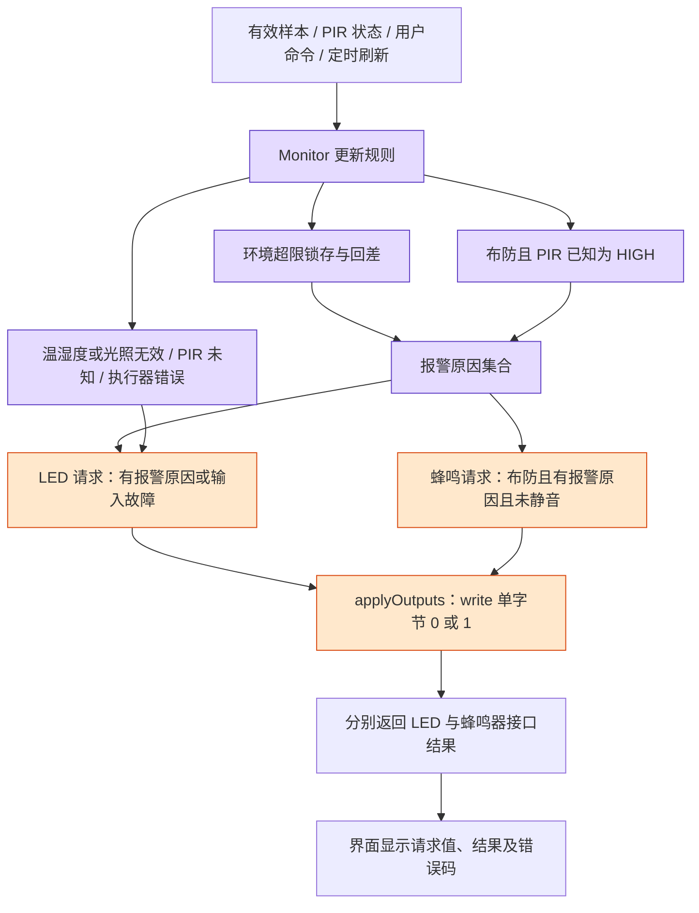
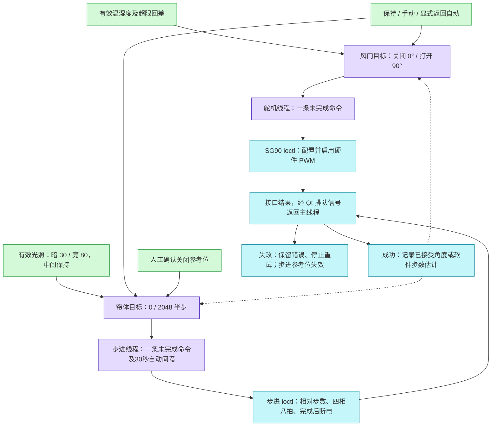

# 当前架构与数据链路

本页对应 `app/` 与 `core/` 的环境辅助控制与离场布防主程序。SG90 和 28BYJ48 已按当前策略接入；历史整机的摄像头、人脸识别、考勤和超声波不参与本程序。代码具备 Linux 设备后端与 Windows/Linux 模拟后端；当前验证覆盖主机，目标板和旧 BSP 的验证状态见[执行器恢复结果](../improvement/actuator-results.md)。

## 系统职责

在固定室内场景读取温湿度、光照和 PIR 电平，显示有效性、故障和报警。温湿度控制风门、明暗控制采光/隐私帘；PIR 仅在人工布防后触发活动提醒，不判断离场或控制电机。机构用途及效果仍待装配确认。

主程序是一个进程：一个 Qt 主线程、三个采集工作线程、两个执行器工作线程。Qt/系统运行库可能另建内部线程，这里的六个线程指应用显式创建的结构。业务状态只在主线程修改。阻塞等待的线程用于隔离接口，并不让单核获得额外计算吞吐；线程、栈和调度开销需板端测量。

```mermaid
flowchart TB
    subgraph inputs["Linux 设备或显式模拟后端"]
        physical["DHT11 / AP3216C / HC-SR505"]
        drivers["GPIO 时序与中断 / I2C / 字符设备"]
        linuxio["LinuxDevices：read / ioctl / poll"]
        simulation["SimDevices：可控样本与故障"]
        physical --> drivers --> linuxio
    end
    subgraph acquisition["三个独立采集工作线程"]
        dht["温湿度：每 2 秒一次尝试"]
        light["光照：每 1 秒一次尝试"]
        pir["PIR：有界 poll 与非阻塞 read"]
    end
    linuxio --> dht
    linuxio --> light
    linuxio --> pir
    simulation -.-> dht
    simulation -.-> light
    simulation -.-> pir
    dht --> bridge["SampleBridge：Qt 排队信号"]
    light --> bridge
    pir --> bridge
    subgraph controller["Qt 主线程"]
        window["MainWindow：交付样本与用户命令"]
        rules["Monitor：有效性 / 超限 / 活动 / 静音"]
        snapshot["Snapshot：状态、计数与输出请求"]
        display["界面与 JSON 日志"]
        output["applyOutputs：状态变化或失败重试"]
        window --> rules --> snapshot
        snapshot --> display
        snapshot --> output
    end
    bridge --> window
    user["布防 / 撤防 / 当前报警静音"] --> window
    output --> switches["Linux 字符设备或模拟开关"]
    switches --> feedback["接口返回值与错误码"]
    feedback --> display
    snapshot --> actuators["ActuatorPolicy：模式 / 目标 / 参考位"]
    window --> actuators
    actuators --> executor["ActuatorExecutor：两个独立工作线程"]
    executor --> motors["SG90 / 28BYJ48 ioctl 或模拟接口"]
    motors -->|结果与错误，经排队信号| bridge
    switches -->|仅 Linux 后端| hardware["LED / 蜂鸣器：物理动作待板测"]
    classDef source fill:#d3f9d8,stroke:#2f9e44
    classDef process fill:#e5dbff,stroke:#5f3dc4
    classDef result fill:#c5f6fa,stroke:#0c8599
    class physical,simulation,user source
    class dht,light,pir,bridge,window,rules process
    class snapshot,display,feedback,hardware result
```

模拟和 Linux 后端二选一。Windows 仅接受显式 `--simulate`；Linux 默认真设备，也可显式模拟。设备失败只产生失败结果，不生成伪造的正常读数。

## 模块与所有权

| 模块 | 职责 | 执行位置与源码 |
|---|---|---|
| 入口 | 参数、后端选择、Qt 初始化、退出码 | 主线程，[main.cpp](../../app/main.cpp) |
| MainWindow | 接收样本、用户操作、定时刷新、输出命令与接口反馈 | 主线程，[mainwindow.cpp](../../app/mainwindow.cpp) |
| Monitor | 不依赖 Qt 或设备系统调用的状态规则 | 主线程调用，[monitor.h](../../core/monitor.h)、[monitor.cpp](../../core/monitor.cpp) |
| Sampler | 三路独立调度、停止标志、唤醒与 join | 三个工作线程，[sampling.cpp](../../core/sampling.cpp) |
| ActuatorPolicy | 模式、有效期门控、参考位/估计、回差和动作间隔 | 主线程，[actuators.cpp](../../core/actuators.cpp) |
| ActuatorExecutor | 每通道一条未完成命令，独立阻塞调用、停止/join、停用 PWM | 两个工作线程，[actuators.h](../../core/actuators.h) |
| Devices | 输入读取、PIR 等待、声光与执行器命令的抽象接口 | [devices.h](../../core/devices.h) |
| LinuxDevices | Linux 字符设备 ABI 与错误传播 | 输入/执行器各自线程；声光由主线程调用，[linux_devices.cpp](../../core/linux_devices.cpp) |
| SimDevices | 可控样本、状态变化和故障注入 | 互斥保护模拟状态，[devices.cpp](../../core/devices.cpp) |
| SampleBridge | 将基本类型的结果复制到 Qt 排队信号 | 发射端在工作线程，接收槽在主线程，[bridge.h](../../app/bridge.h) |

`MainWindow` 拥有后端、采集器、执行器及两组策略；工作对象引用后端。工作线程传递值及错误码，不把驱动缓冲区指针交给界面。温湿度和光照每次尝试独立打开/关闭设备，PIR 线程持有自己的 fd；声光及电机命令分别打开各自节点。不允许其他程序并行驱动同一机构，否则软件步数估计失去依据。

## 三条输入链路

### 温湿度

1. DHT11 驱动产生起始信号，通过 GPIO 双边沿时间戳还原数据并校验。该驱动的微秒级采样行为仍需在目标板确认。
2. 温湿度线程调用 `LinuxDevices::readDht()`，一次 `read` 必须返回两个字节：湿度、温度。
3. 结果为 `DhtReading {ok, temperature, humidity, error}`。采集函数返回后记录应用单调时钟，发出排队信号。
4. 主线程调用 `Monitor::dhtResult()` 更新尝试计数、成功值、最近成功时间和超限状态。
5. 失败立即无效，旧成功值保留并注明年龄；下一个周期再尝试，不在本轮睡眠重试三次。

驱动 [dht11.c](../../01-驱动层/dht11.c) 与用户态 [linux_devices.cpp](../../core/linux_devices.cpp) 的职责分开。应用时间戳是“接口调用返回后的采样结果时间”，不是硬件边沿时间或物理量变化时间；不据此声称端到端测量延迟。

### 光照

AP3216C → BSP 内建 I2C 驱动 → `/dev/ap3216c` → `_IOR('D', 1, unsigned short)` ioctl → 原始 ALS 值 `/1.2` 的估算 → `LightReading` → 排队信号 → `Monitor::lightResult()` → 界面。

这里适配的是 BSP ioctl ABI；仓库自写 AP3216C 的 `read(6)` 实验不是当前后端使用的 ABI。光照不参与温湿度超限判定，而是单独供帘体自动策略使用；近似换算没有计量标定。

### PIR 活动

HC-SR505 输出变化 → GPIO 中断记录最新电平并设置事件标志 → 等待队列唤醒 → 驱动 `.poll` 报可读 → 应用非阻塞 `read(int)` → `PirReading` → 排队信号 → 活动状态与报警。

本轮驱动 [hc_sr505.c](../../01-驱动层/hc_sr505.c) 在首次打开时提供当前电平快照，限制单读取者；没有事件时返回 `EAGAIN`。事件标志和状态不是无损边沿队列，多次变化可能合并为最新状态。没有新边沿也不代表传感器故障，因此 PIR 不按“多久没有事件”判过期。

旧驱动没有 `.poll` 时，poll/read 可能不一致；用户态将就绪后 `EAGAIN` 报为 `EPROTO`，关闭 fd 并退避重开。其他打开或读取失败也报告离线状态。这能避免错误忙轮询，但 GPIO 信号线断开未必引起系统调用错误，不能把 fd 正常等同于电气健康。

## 数据状态与时间

| 状态 | 判据 | 显示与业务行为 |
|---|---|---|
| unknown | 尚无成功值，且没有具体错误 | 不显示为正常数据 |
| valid | 最近尝试成功，最近成功距今不超过 5 秒 | 使用当前成功值 |
| failed | 最近尝试失败 | 显示错误，保留上次成功值及年龄 |
| stale | 曾成功但超过有效期 | 标记过期；不把旧值写成当前正常值 |

温湿度成功样本还检查范围，光照要求有限且非负。失败或过期不自动清除上一次已经触发的环境超限，需后续有效样本达到解除条件。

采集器的默认周期为温湿度 2000 ms、光照 1000 ms、PIR poll 200 ms、离线重试 1000 ms；它们是调度配置，线程调度及内核调用会增加实际间隔。若某次采集超过周期，不补发积压采样。

Qt 刷新定时器为 200 ms。排队信号复制小型结果，但 Qt 事件队列未设置显式容量上限；UI 长时间阻塞时仍可能积压。主线程中的日志输出和设备写调用也不具备独立的硬超时，不能宣称完全隔离或硬实时。

## 报警与输出链路

- 默认撤防。温度 >=30℃ 或湿度 >=75% 置位环境超限；温度 <=28℃ 且湿度 <=70% 才解除。
- 撤防时环境超限和故障仍可亮灯，自动蜂鸣关闭；活动高电平只作为监测状态。
- 布防时，有环境超限或活动报警且未静音，才请求蜂鸣。输入故障本身只亮灯。
- 持续相同报警原因不会反复开启新代次；静音覆盖当前原因集合，新原因出现或清除后重触发会重新允许声音。
- 输出请求变化时立即调用后端；接口失败且请求未变时，下一次重试间隔至少 1 秒。重试依赖主线程再次刷新。

写接口成功只证明驱动接受命令，没有电流、声音或光学反馈。当前输出是开环控制加接口错误反馈，不是物理闭环。LED 和蜂鸣器分开写，不保证两个输出原子同时变化。

执行器错误也计入故障灯，故障本身不请求蜂鸣；PIR 离线仅报告该输入未知，不停止温湿度/光照自动策略。传感器电平正常并不能证明线路和实际场景健康。

## 两条执行器链路

每台电机有 `Hold / Manual / Automatic` 三种模式，启动均为 Hold，不发动作。手动设目标后保持 Manual，新的传感器读数不会覆盖；回到自动必须显式操作。Hold 只禁止新调度，无法取消已经进入内核的动作；SG90 Hold 也不等同于停用 PWM。

舵机自动仅使用有效温湿度：已超限请求打开，达到解除回差请求关闭。`_IOW('S',1,int)` 下发角度，驱动把 0~180° 换算为 20 ms 周期的 0.5~2.5 ms 脉宽，传播 PWM 配置/启用错误。本轮取消 probe 居中动作，新增 `_IO('S',2)` 停用接口。角度和脉宽须按实际舵机、风门限位标定，接口成功不证明已转到位或通风有效。

步进无编码器和限位输入，启动估计未知。操作员确认帘体处于关闭位后，才设软件参考 0；不是驱动自动寻零。默认目标为 0/2048 半步，`_IOW('T',1,int)` 下发相对差值。2048 是待标定示例且为 8 的倍数，以匹配现有驱动每次重置八拍索引的条件。单次驱动上限 ±8192，拍间休眠请求 2~2.2 ms，因此全行程调用会占用工作线程数秒，并非精确定时。

帘体自动采用亮时开、暗时关，中间区间保持，并要求前次动作完成后至少 30 秒才开始下次自动动作；人工动作不受此间隔限制。人工确认参考位仍不能发现丢步、外力拖动、堵转或机构倒转。光照模块的窗侧布置与帘体遮挡关系需实测，避免帘体反过来改变自己的输入。

策略 busy 时更新最新目标而不堆积相对步数，前次结果交回后再算下一条差值。输入失败/过期暂停对应新自动命令，已开始动作继续按内核契约返回。任何步进错误都使估计失效；接口恢复也不会自动重试，需重新确认参考位。驱动部分执行后返回 EINTR，避免信号重启路径重放相对动作；用户态也不重试该 ioctl。舵机失败锁存错误，显式手动或重选自动才允许再试。

## 启动与退出

启动：解析参数 → 明确选择后端 → 创建 Qt 界面和业务状态 → 安装排队连接及空闲执行器线程 → 初始故障/输出刷新 → 启动三个采集线程 → Qt 事件循环。电机保持且帘体参考未知；缺失电机节点在显式动作前不会触发电机访问。

正常关闭或收到 SIGINT/SIGTERM：停止刷新 → 停止/join 三个采集线程 → 丢弃未开始电机任务、等待已开始调用并 join → 曾尝试舵机命令则停用 PWM → 关闭 LED/蜂鸣器 → 记录结果及退出码。关闭声光或停用 PWM 失败返回 1；错误参数或 Windows 真设备模式返回 2。步进驱动在动作返回前断开线圈；未设置其他机械“安全位置”。

停止标志不能强行取消一个不返回的内核 read/ioctl。当前退出依赖匹配驱动的正常返回，主机可取消替身不能证明内核挂死时的退出期限。

## 观察、存储与验证

运行日志按 JSON 输出到标准输出，界面只保留最近 100 个文本块。没有内建数据库、云端上报或断电持久化保证；需要保存时由运行者重定向标准输出。采样次数、失败次数和单调时间用于解释过程，不等同于硬件性能测量。

当前覆盖 Windows Qt 6.11.1 模拟流程、C++11 核心 11 场景、Linux x86_64 原生与 ASan/UBSan，以及三个模块在 5.4 主机头文件下的编译。目标 Qt 5.12.9/ARM、Linux 4.1.15 ABI、物理动作与现场指标仍按[恢复清单](../improvement/board-restoration.md)逐项确认。
